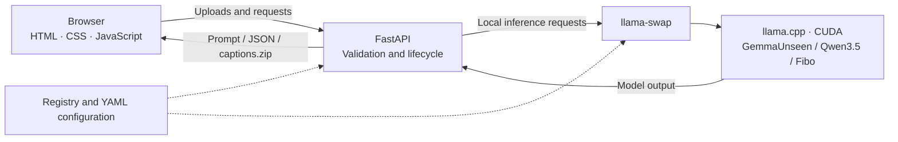

# Prompting Pot

A local image-to-prompt and folder-captioning workspace. FastAPI serves a vanilla HTML/CSS/JavaScript frontend; no Node build is required. Inference runs locally through llama-swap. The application writes prompts and captions—it **does not generate images**.

**This README is the complete user guide.** `PLAN.md` is a development record, not a required setup guide.

## Contents

- [Technology and architecture](#technology-and-architecture)
- [Installation](#installation)
  - [Docker / Compose](#docker--compose)
  - [Local development](#local-development)
- [Model configuration](#model-configuration)
  - [Registry and model files](#registry-and-model-files)
  - [GPU IDs and machine-specific YAML settings](#gpu-ids-and-machine-specific-yaml-settings)
  - [Context and output budgets](#context-and-output-budgets)
- [Using the application](#using-the-application)
  - [From an image](#from-an-image)
  - [From words](#from-words)
  - [Caption a folder](#caption-a-folder)
  - [Output controls](#output-controls)
- [Caption and JSON formats](#caption-and-json-formats)
- [Container operations](#container-operations)
- [Troubleshooting](#troubleshooting)
- [Security and limitations](#security-and-limitations)
- [Technical reference](#technical-reference)
- [Verification](#verification)
- [Publishing safely](#publishing-safely)
- [Format sources](#format-sources)

## Technology and architecture

| Layer | Tools / technologies |
|---|---|
| 🎨 Interface | HTML, CSS, vanilla JavaScript · persistent light/dark themes |
| ⚡ Application | Python 3.12+ · FastAPI · Uvicorn |
| 🧠 Local inference | llama-swap · llama.cpp · NVIDIA CUDA · async OpenAI-compatible SDK |
| 🔍 Models | GemmaUnseen · Qwen3.5 Captioning · Fibo Scene Analyzer |
| 🖼️ Images and output | Pillow · JSON Schema / Pydantic validation · UTF-8 captions and ZIP downloads |
| 📦 Packaging | uv + locked dependencies · Docker · Docker Compose · NVIDIA Container Toolkit |
| 🧪 Quality checks | pytest · Node.js test runner · selected Playwright browser checks · Gitleaks |



Docker Compose packages the application and inference tools together; model files are mounted read-only. Image-generator choices select prompt formats—not image-generation services.

## Installation

### Docker / Compose

Recommended for a self-contained NVIDIA installation.

**Host requirements:**

- Linux with Docker Engine and modern Docker Compose (v2 or newer).
- NVIDIA GPUs and a host driver compatible with CUDA 12.8 and your GPUs.
- [NVIDIA Container Toolkit](https://docs.nvidia.com/datacenter/cloud-native/container-toolkit/latest/install-guide.html), installed and configured for Docker.
- Your model weights, vision projectors (mmproj), required chat templates, and sufficient GPU/system memory.

No host Python environment, llama.cpp executable, llama-swap executable or CUDA compiler is needed. The image includes:

- The official prebuilt CUDA llama.cpp image, pinned by digest; the tested build is b11459 (`f498f864f`), CUDA 12.8 / Ubuntu 24.04.
- Checksum-verified llama-swap v262.
- Python dependencies installed from `uv.lock`, using digest-pinned uv.

Models are **not** downloaded or included in the image. The build downloads the pinned images, llama-swap and locked Python packages. Inference has no remote fallback.

#### Configure host paths

Default read-only mounts:

| Host source | Container destination | Purpose |
|---|---|---|
| `./config` | `/app/config` | Registry and llama-swap YAMLs |
| `/mnt/llm/models` | `/mnt/llm/models` | GGUF weights, mmproj files and chat templates |

For another model directory, configuration directory or public port:

```sh
cp .env.example .env
# Edit APP_PORT, MODELS_DIR and CONFIG_DIR in .env.
```

For example:

```dotenv
APP_PORT=8000
MODELS_DIR=/data/my-models
CONFIG_DIR=./config
```

`MODELS_DIR=/data/my-models` still mounts at `/mnt/llm/models` **inside** the container. Match the paths in your YAMLs to that container location, not the host location.

Missing mount source directories cause startup to fail rather than creating empty folders. Files/directories must be readable/traversable by container UID/GID **10001**. Symlinks pointing outside the model mount will not resolve inside the container. Do not fix permission errors by making sensitive files world-writable.

#### Build and start

Review [model configuration](#model-configuration), especially GPU IDs, before starting:

```sh
docker compose config --quiet
docker compose up -d --build --wait
```

Open **http://localhost:8000**, or your chosen `APP_PORT`. From another trusted machine, use the host's LAN IP. The service listens on `0.0.0.0` and Compose publishes it on all host interfaces.

If a local server already uses port 8000, stop it or choose another `APP_PORT`.

The container runs as a non-root user, with **one Uvicorn worker and no development reloader**. Only the application port is published; llama-swap and model-server ports stay inside the container. No privileged mode, host networking or Docker socket mount is required.

The pinned image and llama-swap archives support amd64 and arm64. Build/runtime verification was performed on **Linux amd64**; arm64 remains untested.

### Local development

Install Python 3.12+, [uv](https://docs.astral.sh/uv/), CUDA-enabled llama.cpp and llama-swap. Ensure `llama-server` and `llama-swap` are available on `PATH`, and install an appropriate NVIDIA driver.

From the repository checkout:

```sh
uv sync --group dev
uv run prompting-pot
```

Open **http://localhost:8000**. The local development entrypoint listens on `0.0.0.0` with reloading enabled. Interactive API documentation is at `/docs`.

For another working directory or a packaged install, set `PROMPTING_POT_ROOT` to the absolute directory containing `config/`. Docker already sets it to `/app`.

## Model configuration

### Registry and model files

Edit `config/targets.json` and place each dedicated llama-swap YAML inside `config/`.

Each entry contains:

| Field | Meaning |
|---|---|
| `id` | Unique, exact llama-swap API model ID; must match its YAML model key |
| `name` | Display name in the interface |
| `config` | YAML filename relative to `config/` |
| `vision` | Boolean indicating whether the local model accepts images |

Current entries:

| Registry ID | YAML | Supported workflow |
|---|---|---|
| `GemmaUnseen` | `unseen.yaml` | Krea2 folder training captions and single-image prompts for Krea2, Z-Image, FLUX.2 Klein, Anima and Qwen-Image-2.1 |
| `Captioning` | `caption.yaml` | Krea2 folder training captions and single-image Qwen-Image-2.1 text / Ideogram 4 JSON |
| `Fibo` | `fibo.yaml` | Single-image Ideogram workflow, using native Fibo JSON |

These IDs are intentionally used instead of names from the reference scripts, such as `Qwen35Captioning`. Configurations must be registered YAML files inside `config/`; model startup verifies that the selected file exists.

**An image-generator name is not a local model ID.** Krea2, Z-Image, FLUX.2 Klein, Anima and Qwen-Image-2.1 select prompt templates. Do not add them to the registry unless you actually serve a local prompt-writing model with that API ID. Workflow restrictions are implemented in the application; adding a registry entry alone does not add a new supported workflow.

Verify every model's GGUF, mmproj and chat-template paths. Fibo needs its trained chat template and special-token settings. Do not put credentials in committed configuration files.

### GPU IDs and machine-specific YAML settings

**You must adapt the YAML files to the machine where the application runs.** Docker exposing all GPUs does not automatically rewrite model commands or select the best GPU.

Compose uses `count: all`, `capabilities: [gpu]` and `NVIDIA_VISIBLE_DEVICES=all`, with `compute,utility` driver capabilities. This makes all GPUs available; it does **not** force each model to use all GPUs.

Check the available CUDA devices:

```sh
# Docker
docker compose exec prompting-pot nvidia-smi
docker compose exec prompting-pot llama-server --list-devices

# Local installation
llama-server --list-devices
```

Use the CUDA device indices reported by llama.cpp; enumeration can differ across machines and tools.

- **One GPU:** use `--main-gpu 0`. The supplied caption YAML uses `--main-gpu 1`, so it must be changed on a single-GPU machine.
- **Multiple GPUs:** select a valid index according to each model's memory needs. GPU 0/1 labels from another machine are not portable.
- Review GPU splitting/offload settings such as `--split-mode`, `--tensor-split` and `-ngl` when configuring multi-GPU inference. Existing `--split-mode none` settings select a single GPU rather than distributing a model across all cards.
- Review context size, KV-cache settings and model quantization against available memory.
- Update GGUF/mmproj/chat-template paths if your directory layout changes.

The provided YAMLs are starting configurations for the original machine, not universal hardware settings. The application deliberately leaves them under your control.

### Context and output budgets

Image tokens, system/user instructions and output all consume context.

- The supplied Gemma configuration uses a 4096-token context; ordinary image prompts request up to 2000 output tokens.
- Ideogram Qwen requests explicitly ask for 4096 output tokens, overriding the YAML's 1024-token generation default. This does not increase the model's context capacity.
- Fibo requests 4096 output tokens. Its context/template configuration must accommodate the image and output together.

If inference fails or truncates, inspect the model's context, output budget, memory and installed server/template support. Increase budgets deliberately, not simply to the largest possible value.

## Using the application

### From an image

Upload or drag/drop a **PNG, JPEG or WebP**, up to **10 MB**. All target image generators remain visible so you can switch workflows directly.

| Target image generator | Prompt-writing model choices | Output |
|---|---|---|
| Krea2, Z-Image, FLUX.2 Klein, Anima | GemmaUnseen only, selected automatically | Generator-specific prompt text |
| Qwen-Image-2.1 | GemmaUnseen by default, or Qwen3.5 Captioning | Gemma prompt sections or a Qwen descriptive paragraph |
| Ideogram 4 | Fibo by default, or Qwen3.5 Captioning | JSON; the two models use different schemas |

For **GemmaUnseen**, optionally describe changes. Empty changes or “as-is” request reconstruction without changes. Krea2, FLUX and Anima request raw prose; Z-Image and Qwen retain their original breakdowns/sections. Headings and code fences are preserved. The Qwen generation template uses the uploaded image only for Gemma's analysis: its copyable output describes the finished scene without downstream editing/reference instructions. Requested changes are expressed as final visual attributes. Detail follows scene complexity rather than a mandatory word count; composition, lighting, materials, palette and exact readable typography receive concrete descriptions.

For **Qwen-Image-2.1**, Qwen3.5 uses its standalone descriptive-caption template and server generation defaults, returning plain text rather than JSON. It describes the image as-is, with change instructions disabled; Gemma still accepts optional changes.

For **Ideogram 4**, analysis is **as-is**: change instructions are disabled and nonempty API instructions are rejected.

- **Fibo:** native scene analysis (`general` / `objects`), downloadable as `fibo-scene.json`. Coordinate/color tokens are converted to numbers, including nested objects. This native schema is not converted into the Ideogram caption schema; selecting Ideogram indicates its intended workflow, not verified downstream schema compatibility.
- **Qwen3.5 Captioning:** a dedicated constrained, validated single-image Ideogram JSON path, downloadable as `ideogram4-caption.json`. An explicit Qwen choice is preserved; Fibo remains the default.

Gemma remains **excluded from Ideogram by user choice**. A live feasibility evaluation produced validated JSON in 3/3 requests across two images, but found inconsistent complex-text transcription and palette fidelity. This small evaluation did not establish Qwen-equivalent accuracy.

If a required model is missing, generation is disabled instead of silently choosing an unrelated model. Clear the generator selection to restore the unfiltered image-mode model choices.

### From words

Choose a target image generator and a local prompt-writing model, then describe the desired scene. No image is uploaded or required.

| Target | Local models | Output |
|---|---|---|
| Krea2, Z-Image, FLUX.2 Klein, Anima, Qwen-Image-2.1 | GemmaUnseen (default) or Qwen3.5 | Generator-specific text prompt |
| Ideogram 4 | Fibo (default) or Qwen3.5 | Validated JSON; native Fibo scene schema or Qwen's Ideogram schema |

Generator rules are adapted to text-only scene creation, preserving your explicit details and requested writing while adding coherent visual details. Qwen's Ideogram path uses constrained decoding and the existing validator. Fibo uses its documented `<expand><full>` task with a **square (1.00) aspect-ratio default**, no image and native validation. Native Fibo JSON remains a different format; downstream Ideogram compatibility is not established merely by schema validation.

Fibo text expansion passed two local smoke tests (fox in snow and a teapot scene), both producing validated native JSON. This is limited evidence, not a broad quality comparison. Empty, malformed or truncated output fails instead of returning a fabricated or partial prompt.

### Caption a folder

Folder captioning is exclusively for **Krea2 LoRA training**. Choose **Qwen3.5 Captioning (NSFW)** (the default) or **GemmaUnseen**, then **Character** or **Style**, supply a required trigger word, and select a folder through the browser. Both models use the same natural-sentence training rules, never comma-separated tags. Your caption-model choice is remembered independently of the single-image model while the page stays open. If only one eligible model is configured, it is selected automatically.

- Top-level PNG/JPEG/WebP/BMP images only; hidden files and subfolders are ignored.
- Maximum **150 images**, **100 MB total**, **10 MB per image**.
- Images are processed sequentially; the model starts/reuses once for the batch.
- Both types write `.txt` sidecars and skip matching existing `.txt` captions. `.json` files in the selected folder are ignored.
- Existing caption contents are not uploaded—only filenames are sent for skipping.
- Rename images sharing a caption filename, such as `photo.jpg` and `photo.png`.
- `caption-manifest.json` contains batch reporting; a `caption-manifest.png` image safely gets its own `caption-manifest.txt` sidecar.

Results download as `captions.zip`, containing UTF-8 sidecars and `caption-manifest.json` with counts and per-image outcomes. Extract the ZIP into your original image folder. Failed images do not receive empty or invalid sidecars; other images continue processing.

**Browser limitation:** a folder picker does not provide a writable original filesystem path to FastAPI. The application creates a ZIP, not files in your original folder. It does not create a permanent server-side output directory.

### Output controls

A solid-color progress bar follows the current light/dark theme, with a small flower beside its status. Folder captioning shows **processed / total images**, counting captioned, skipped and failed images alike—not promising that every processed image has a `.txt`. Upload/model preparation and single-image/text inference use an indeterminate waiting bar, never invented percentages. Motion is disabled when your system requests reduced motion. The bar clears on completion or error; final counts and the manifest explain batch outcomes.

JSON is automatically pretty-printed. Output is selectable and vertically resizable.

- **Copy** copies the prompt, JSON or batch summary.
- **Clear** resets output, its format badge and download link without changing your inputs or model choices. It is disabled for empty output and during generation.
- **Download** saves JSON for single-image analysis, or a ZIP for folder captions.

The light/dark toggle remembers your preference. Nunito Sans is fetched from Google Fonts; offline use falls back to Trebuchet MS. Images and prompts are not sent to the font service.

## Caption and JSON formats

### Krea2 Character and Style captions

**Main rule: caption the dataset in natural sentences, not comma-separated tags.** Both types produce concise English prose beginning with the exact trigger word followed by a space.

| LoRA type | What the caption describes |
|---|---|
| **Character** | Outfit, pose/action, lighting and background. Exclude the face, facial expression, eyes, skin tone, hair, age, ethnicity, body shape and other fixed identity features; let the trigger carry identity. |
| **Style** | Visible content normally: subjects, appearance, objects, clothing, action, composition, lighting and background. The character-specific feature exclusions do not apply. Let the dataset's consistent aesthetic carry the style rather than repeating aesthetic labels or artist/style tags. |

Examples with trigger `TOK`:

- **Character:** `TOK wears a blue cotton jacket and stands beside a wooden fence. Soft light falls from the left, with a garden in the background.`
- **Style:** `TOK depicts a cat curled on a red cushion beside a window. Afternoon sunlight illuminates the cushion, and a potted plant stands behind it.`

The two Character/Style templates are model-independent and shared by Qwen3.5 and GemmaUnseen, so their training rules cannot drift between models. Gemma uses its existing multimodal adapter with reasoning disabled; no separate generation-style breakdown is requested for captions.

Both require a nonempty **single-line trigger**, up to **200 characters**; surrounding input whitespace is trimmed while spelling/case are preserved. Captions missing the exact trigger-space prefix are reported as per-image failures and are not written. Natural-prose adherence and the exclusion of fixed features are model instructions, not reliable semantic validators: review captions before training. Existing `.txt` captions are skipped without inspecting or rewriting their contents; move old tag captions aside if you want to recaption them.

The former Standard/Tagged, Qwen and Ideogram **folder** formats have been removed. Single-image Gemma, Qwen-Image-2.1 text, Ideogram JSON and Fibo workflows remain available; their shared adapters and validation are retained.

### Ideogram caption schema

Qwen's Ideogram caption is structured JSON, serialized as a string—not a generic object containing one `prompt` key.

Required root fields for this task:

1. `high_level_description`
2. `style_description`
3. `compositional_deconstruction`

The official format requires composition; this application's image-caption task requires all three for useful descriptions.

Canonical ordering and constraints:

- **Photographic style:** `aesthetics`, `lighting`, `photo`, `medium`, optional `color_palette`; medium is `photograph`.
- **Non-photographic style:** `aesthetics`, `lighting`, `medium`, `art_style`, optional `color_palette`.
- Use exactly one of `photo` / `art_style`.
- **Composition:** `background`, then `elements`.
- **Object element:** `type`, optional `bbox`, `desc`, optional `color_palette`.
- **Text element:** `type`, optional `bbox`, `text`, `desc`, optional `color_palette`.
- Bounding boxes are optional `[y_min, x_min, y_max, x_max]` integers normalized to **0–1000**, with lower bounds no greater than upper bounds. Omit uncertain locations.
- Palettes use uppercase `#RRGGBB`: at most **16 overall colors** and **5 per element**.
- UTF-8 serialization preserves non-ASCII text, uses compact separators and restores canonical key order.

The prompt describes visible details and exact readable typography without inventing identities or unreadable text. Malformed JSON, duplicate keys, unknown fields, invalid geometry/palettes and truncated output are rejected. Single-image failures return 502; batch failures are listed in the manifest, with no invalid `.json` sidecar.

### Model capability versus decoder support

Qwen's Ideogram requests send `response_format` JSON Schema, `max_tokens=4096` and `reasoning: off`. The installed llama.cpp and chat template must support them. Unsupported schema features may be ignored by the decoder, so backend schema/geometry validation is mandatory. Unsupported requests fail visibly; there is no silent plain-text fallback.

Fibo deliberately does **not** send JSON Schema: the supplied adapter reports llama.cpp's constrained decoder rejecting its special-token JSON. Its native output is validated with the vendored Pydantic schema instead.

Valid JSON is not proof of accurate visual grounding. The exact Qwen captioning fine-tune's inspected model card did not establish a JSON-quality benchmark; some live requests have been verified, but broad reliability still requires diverse image tests. Actual Ideogram generation has its own safety filter; valid JSON does not bypass it.

## Container operations

### Status and diagnostics

```sh
docker compose ps
docker compose logs -f prompting-pot
docker compose exec prompting-pot nvidia-smi
docker compose exec prompting-pot llama-server --list-devices
```

The health check validates HTTP API/registry loading without loading a model. A healthy container does not prove valid model paths, sufficient GPU memory or successful inference for every model.

### Stop, resume and auto-start

```sh
docker compose stop       # retain the stopped container
docker compose start      # resume it
docker compose restart    # restart the existing container
docker compose down       # stop and remove container/network
```

`restart: unless-stopped` restarts after crashes and Docker/host restart **after the container has been created**, unless it was stopped manually. Docker itself must start at boot. After `down`, there is no container to auto-start until the next `up`. An unhealthy status alone does not trigger this restart policy.

Compose supplies an init process and a **45-second stop window**. Uvicorn allows **15 seconds** for requests before cancellation; the existing lifecycle terminates owned model process groups, with a **10-second** forced-kill fallback. Interrupted requests may fail in the browser; partial captions are not saved. A SIGTERM exit status such as 143 is expected and is not an OOM error.

### Update, rollback and distribution

```sh
# Save the current image, then build/start the new revision.
docker tag prompting-pot:0.1.0 prompting-pot:previous
docker compose up -d --build --wait

# Roll back without rebuilding.
docker tag prompting-pot:previous prompting-pot:0.1.0
docker compose up -d --no-build --force-recreate --wait
```

Image rollback does not revert your host-mounted configuration/model changes. Review upstream security updates and update image pins/lockfile deliberately.

For distribution, publish the built image to your registry or use `docker save` / `docker load`. Recipients still need the NVIDIA prerequisites, Compose/configuration files and their model files. Build context excludes local caches, Git history, tests, evaluation artifacts, model weights and local environment settings.

## Troubleshooting

| Symptom | Check |
|---|---|
| GPU unavailable / NVIDIA runtime error | Host driver and NVIDIA Container Toolkit; run `nvidia-smi` inside the container |
| Invalid CUDA device index | Adjust `--main-gpu` in the relevant YAML; one GPU means index 0 |
| Model/mmproj/template missing | Container-visible YAML paths, mount source, directory layout, symlinks and UID 10001 read permissions |
| Port 8000 already used | Stop the local server or change `APP_PORT` |
| Port 8080 occupied but API not ready | Inspect the existing service; the app refuses to start a competing llama-swap |
| Wrong model choices after an update | Refresh with **Ctrl + Shift + R** |
| HTTP 422 | Required image/model/style/trigger, supported model-generator pairing, filename collisions or limits |
| HTTP 501 in From words | An older application build is running; update/rebuild, restart and refresh the browser |
| HTTP 502 / invalid or truncated JSON | Server/template support, model output, context/output budget and memory; check logs |
| HTTP 503 | Startup failure, missing configuration/executable, occupied port or readiness timeout |
| Existing captions not skipped | Matching image stem and selected extension: `.txt` for text, `.json` for Ideogram |
| Batch partially fails | Read `caption-manifest.json`; successful files remain in the ZIP |

If reusing an externally started llama-swap server, ensure it actually serves the required model configuration. Readiness alone cannot establish which YAML it loaded.

## Security and limitations

- `0.0.0.0` is a **bind address**, not a portable browser/client destination. Open `localhost` or the host's LAN IP. Existing `IP` / `BASE_URL` values in `llama_swap.py` are not rewritten by this packaging.
- The application is **unauthenticated** and exposed on all requested host interfaces. Use a trusted network/firewall; do not expose it directly to the public Internet. Authentication, TLS and public reverse-proxy deployment are not included.
- Treat it as a local, single-user application. Use **one worker/instance**; inference locks and process ownership are not shared across workers or replicas.
- Prompts/images are not persisted by the application. The frontend never supplies server filesystem paths or shell commands.
- No automatic inference retries, remote fallback or token-by-token model streaming are implemented. Folder progress streams per-image outcomes around the inference requests; closing the connection cancels the application batch and releases its model lock/resources.
- Different GPU layouts, text/image prompt quality, larger inputs and arm64 need deployment-specific verification.

## Technical reference

### Owned llama-swap lifecycle

`src/prompting_pot/llama_swap.py` is connected through `ensure_llama_swap()` / `inference_session()` in `app.py`:

1. Check `BASE_URL + /models`; reuse a ready external API without claiming ownership or stopping it.
2. Refuse an occupied but unready port with 503.
3. Otherwise validate the YAML, start llama-swap, print its PID and wait up to **30 seconds** for API readiness. Child terminal output is suppressed.
4. Hold the lifecycle lock throughout inference and cleanup. Stop owned processes after a single request or the entire caption batch, including failures.
5. On Linux, send SIGTERM to the owned process group, wait up to **10 seconds**, then use SIGKILL if needed. Shutdown also cleans up remaining owned processes.

Local installations supply their own llama.cpp/llama-swap; Docker includes them. Neither mode kills an externally started server.

### Inference settings and editable prompts

All templates live in `src/prompting_pot/prompts.py`; external reference scripts are not runtime dependencies.

| Path | Settings |
|---|---|
| Gemma image prompts / folder captions (`gemma_unseen.py`) | Generator or Krea2 LoRA system prompt plus image/instructions; temperature 0.7, 2000 output tokens, reasoning off, 300-second timeout |
| Qwen text captions (`captioning.py`) | Image/instructions; generation settings left to the server, 300-second timeout |
| Qwen Ideogram JSON | Same caption adapter; schema-constrained 4096-token request with reasoning off, 300-second timeout |
| Fibo (`fibo.py`) | RGB PNG, image before `<caption><full>`, no system message; temperature 1.0, top_p 0.95, top_k 20, min_p 0, 4096 output tokens, direct answers, 3600-second timeout |

Fibo sends `special: true` and `skip_special_tokens: false`. `fibo_schema.py` vendors native validation/token processing, omitting the unused NumPy mask-rasterization helper. Invalid, duplicate-key, nonfinite or truncated native JSON fails rather than returning a partial result.

`build_image_prompt()` selects Gemma's five generator-specific system templates. The Qwen-Image-2.1 generation template has been revised for standalone generation using the supplied PDF; single-image caption templates are separate. `FOLDER_CAPTION_STYLES` contains only Krea2 Character/Style prose templates; `build_caption_request()` also retains Qwen-Image-2.1 and Ideogram instructions for single-image use; Fibo uses `FIBO_CAPTION_PROMPT`. `ideogram_caption.py` owns Ideogram schema validation and canonical serialization, without requiring an Ideogram runtime. `text_generation.py` sends text-only requests using `build_text_prompt()` for the chosen generator, schema-constrained Qwen JSON or Fibo's native expansion task. The legacy generic templates and `TARGET_PROMPTS` do not drive this connected path.

The async OpenAI SDK uses its compatible HTTP client with proxy environment variables bypassed for local requests. HTTP/connection/timeout/empty-response failures are surfaced; no remote fallback or fabricated output is supplied.

### API contract

Interactive documentation: `/docs`.

- `GET /api/targets`: registered IDs/names with `vision`, `captioning`, `image_generators`, `analysis_only` and `text` workflow flags. Folder captioning accepts registered vision-capable `Captioning` and `GemmaUnseen` models only.
- `GET /api/image-generators`: available generator IDs/display names, including `ideogram4`. The UI keeps the full generator list visible and filters the model dropdown; the backend checks model/generator compatibility.
- `POST /api/generate`: multipart `target_id`, `mode` (`image` / `text`), `description`, required `image_generator` in both modes, and required `image` only in image mode. Text mode rejects uploaded images and incompatible model/generator choices. Qwen/Fibo as-is single-image analysis rejects change instructions.
- `POST /api/caption`: multipart `target_id` (`Captioning` or `GemmaUnseen`, vision-capable only), repeated `images`, `existing_captions` (JSON list of flat `.txt` filenames), `caption_style` (`character`, the default, or `style`) and required `trigger_word`. Removed format IDs return 422 before startup. By default, returns a ZIP of `.txt` captions and the manifest, with `X-captioned`, `X-skipped` and `X-failed` headers. With `Accept: application/x-ndjson` (used by the UI), streams newline-delimited `stage`, `progress` and terminal `complete` / `error` events. Progress carries processed/total counts, filename and outcome counts; completion carries counts and a base64-encoded ZIP that the browser decodes into the normal download. Input validation still returns ordinary HTTP errors; failures after streaming begins use an `error` event. No persistent jobs/files are created. Reverse proxies must allow unbuffered streaming.
- Generation success: `{"output": "prompt text or serialized JSON"}` or `{"output": {"general": {}, "objects": []}}` for native structured output. These illustrate response shapes, not fabricated model results.
- Errors use FastAPI's standard `detail` field; batch inference/image failures are recorded per image in the manifest.

## Verification

```sh
uv run pytest
node --check src/prompting_pot/static/app.js
node --test tests/test_drop.cjs
docker compose config --quiet
```

Compose contract tests skip when the Docker CLI/Compose plugin is absent; they do not start containers or require a daemon. Automated inference tests primarily use mocks or local fake HTTP APIs.

Actual container verification included a successful image build, healthy non-root API on temporary port 18000, both RTX 5060 Ti and RTX 5090 visible, matching packaged frontend JavaScript, and real Qwen Ideogram GPU inference passing the schema validator. Owned model processes were absent afterward, and the temporary container/network were removed without affecting the host app.

Selected Chromium checks cover model/generator switching, Qwen JSON rendering/download with mocked inference, and Clear preserving inputs. This is not a complete browser/visual audit. Before shipping to a different environment, check narrow layouts, keyboard navigation, both themes, uploads/removal, folder selection, downloads, error handling and real-model results. Other models' container accuracy, different GPU layouts and arm64 remain deployment-specific checks.

## Publishing safely

### Audit result and substitutions

The pre-publication audit inspected the 36 Git-publishable files before this documentation update, including the lockfile, configurations, source, tests and supplied PDF. A local, checksum-verified **Gitleaks v8.30.1** scan reported no credential findings. Additional checks found no personal home-directory paths, email addresses or private IP addresses in the inspected source/docs, or the PDF's extracted text. The PDF has only generic producer metadata, with no author metadata, attachments, form fields or URI annotations.

At audit time there were **no commits or staged files**, so there was no committed/staged history to remediate. This describes the audit scope, not a guarantee about future changes or every possible secret format.

**No sensitive value substitutions were necessary.** The following values were reviewed and deliberately retained:

| Reviewed category | Disposition / what users must configure |
|---|---|
| Local SDK API-key strings `local` / `llama` | Non-secret placeholders for the current unauthenticated local backend; not cloud credentials. Do not replace them with live credentials in committed source. |
| `/mnt/llm/models`, `/app/config`, `.env.example` paths | Generic deployment defaults/examples, not personal directories. Configure host paths through your ignored `.env` and model paths through the YAMLs. |
| `0.0.0.0`, localhost and loopback addresses | Bind/local-service addresses, not private network inventory. All-interface exposure still requires the security precautions above. |
| Public checkpoint filenames, GPU macro labels and device indices | Configuration examples, not credentials. They remain unchanged so the existing model commands keep working; adapt them to your machine as described above. |
| Image digests, archive checksums and dependency hashes | Public integrity/version pins, not authentication tokens. |

The preventative changes were to **`.gitignore`**, not runtime values. It now explicitly excludes local environment files (except `.env.example`), tool caches/coverage, logs, private-key material, local database files, GGUF/safetensors weights, and root-level `models/`, `private/`, `uploads/`, `outputs/`, `evaluation-results/` and `audit-reports/` directories. Keep personal inputs/results and raw audit reports in those private locations, not beside public examples. Ignore rules are a safeguard—not a secret scanner—and do not protect files already tracked or force-added.

### Before each push

With [Gitleaks](https://github.com/gitleaks/gitleaks) installed locally:

```sh
# Stage intended public files, then inspect exactly what will be committed.
git add .
git diff --cached --stat
git diff --cached

gitleaks git --staged --redact
# After commits exist, also check the repository history.
gitleaks git --redact
```

Review documents and binary metadata as well as code; secret scanners do not establish that every image/PDF is free of personal information. If a real credential is found, revoke/rotate it; removing it from the latest file does not remove it from Git history. Do not copy the original secret into a replacement log or README.

GitHub commits also publish your Git author name/email. Review your identity before the first commit; if desired, use the GitHub-provided no-reply email in this repository rather than publishing a personal address. No Git identity, remotes or history were changed by this audit.

## Format sources

- [Supplied Qwen-Image-2.1 guide](Qwen21_Editguide.pdf): generation-template refinements draw on pages 11–16, 20–22, 25 and 27. Editing/multi-reference commands are deliberately excluded. The update has prompt-contract/regression tests; better downstream Qwen image quality remains to be established with comparison testing.

- [Fibo supported tasks](https://huggingface.co/briaai/fibo-scene-analyzer): documents text-only scene expansion.
- [Fibo GGUF usage](https://huggingface.co/briaai/fibo-scene-analyzer-gguf): documents `<expand>` support on llama.cpp.
- [Ideogram 4 prompting guide](https://github.com/ideogram-oss/ideogram4/blob/main/docs/prompting.md)
- [Ideogram 4 caption verifier](https://github.com/ideogram-oss/ideogram4/blob/main/src/ideogram4/caption_verifier.py)
- [llama.cpp OpenAI-compatible request parsing](https://github.com/ggml-org/llama.cpp/blob/master/tools/server/server-common.cpp)
- [llama.cpp schema/grammar limitations](https://github.com/ggml-org/llama.cpp/blob/master/grammars/README.md)
- [Exact Qwen captioning fine-tune's GGUF card](https://huggingface.co/mradermacher/qwen3.5-9b-nsfw-captioning-v5-GGUF)

The Ideogram guide/verifier were inspected before implementation. The fine-tune's inspected quantization card did not establish JSON-format accuracy; an accessible original-repository README was not available at the inspected URL. Qwen-Image-2.1 caption rules were adapted from the supplied `krea2_prompt.py`, retained in `prompts.py`, not presented as a newly verified official caption recipe.
